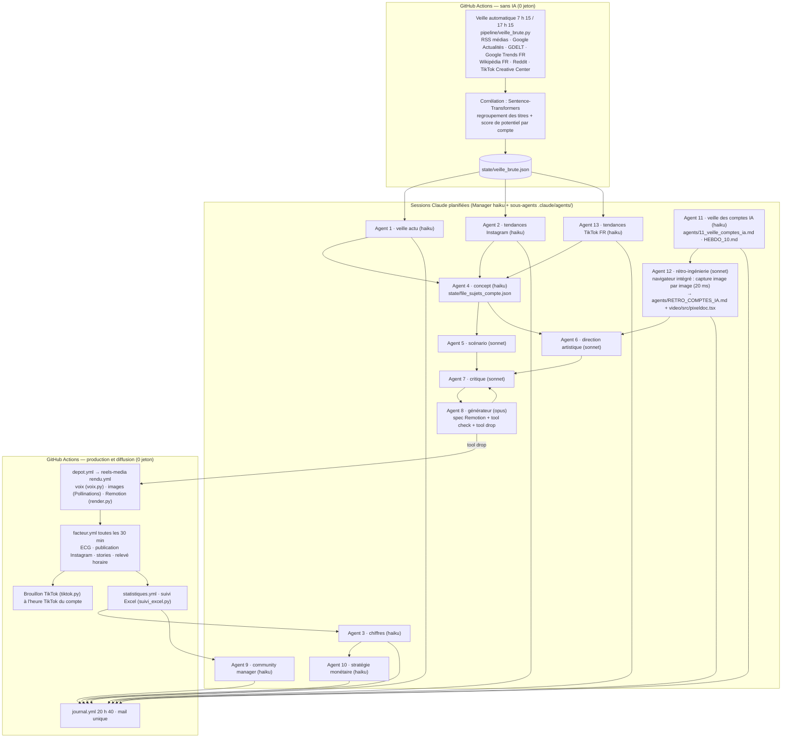

# Architecture de Décodé Studio (reels-factory)

Les agents 11 et 12 n'ont pas de code Python : ils tournent dans les sessions Claude planifiées (17 h 50) et
utilisent le navigateur intégré (Instagram connecté) ; leurs règles sont dans `agents/`, `HEBDO_10.md`,
`.claude/skills/veilles-du-soir/` et leurs résultats dans `agents/RETRO_COMPTES_IA.md`.
